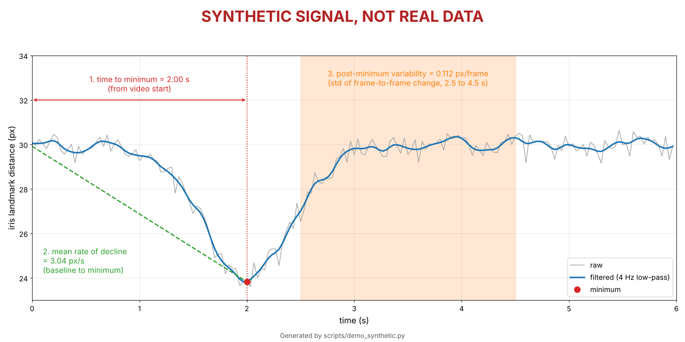

# Optira

Student prototype: phone video to pupillary light reflex features, toward screening for early diabetic autonomic neuropathy. Unvalidated.

[](https://github.com/nave-neptunus/optira/actions/workflows/ci.yml)

[](LICENSE)




*Synthetic signal, not real data.* Made by [`scripts/demo_synthetic.py`](scripts/demo_synthetic.py).

## Status in one paragraph

Optira was our entry in HOSA Medical Innovation in January 2026, built with my teammate Nithilan M. It did not advance past the qualifying round. There is no human data, and this is not a medical device.

## Try it in 60 seconds

```bash
pip install -r requirements.txt && pip install -e . pytest && pytest && python scripts/demo_synthetic.py
```

No video, camera or MediaPipe is needed. The script rewrites the figure above.

## Pipeline


The three features are time to minimum, mean rate of decline and post-minimum variability ([`features.py`](src/optira/features.py)). The JSON also carries a fourth value, `rmssd`, which does not affect the rule.

## What works

| Part | What it does | Where |
|---|---|---|
| Landmark distance | Distance between face-mesh landmarks 468 and 470, in pixels | [`signal.py`](src/optira/signal.py) |
| Filter | Order-2 Butterworth low-pass at 4 Hz, zero phase | [`filtering.py`](src/optira/filtering.py) |
| Features | Time to minimum, mean rate of decline, post-minimum variability, `rmssd` | [`features.py`](src/optira/features.py) |
| API | `POST /analyze` and `GET /health` in Flask | [`server.py`](src/optira/server.py) |
| Tests | Run on synthetic signals with a fake extractor, no video needed | [`tests/`](tests/) |

The video reader, `extract_series`, is ported from the original notebook. It needs OpenCV and MediaPipe (`requirements-video.txt`) and is not covered by the tests in this repo.

The code keeps the logic of the original Colab notebook, flaws included. [`docs/original-vs-package.md`](docs/original-vs-package.md) maps each notebook cell to a module. [`tests/test_known_limitations.py`](tests/test_known_limitations.py) pins the flaws so they cannot change unnoticed.

## What is placeholder

| Item | What it does | Why it is a placeholder |
|---|---|---|
| Screening rule ([`screening.py`](src/optira/screening.py)) | Flags abnormal if time to minimum is over 0.4 s or mean rate of decline is under 15 px/s | Fixed thresholds with no source, no tuning and no data behind them. 15 px/s depends on camera resolution and distance, so it cannot transfer between phones. |
| `probability` | Constant 0.7 if flagged, 0.3 if not | It is not a probability. |
| `graphs` | The literal string `base64_graph_data` for both graphs | No image is generated. |
| `hippus_irregularity` and `rmssd` | Returned in the JSON | They do not affect `prediction`. |
| Logistic regression cell (not ported) | Trained on 4 hand-typed rows with hand-written normal and abnormal labels | `test_size=0.25` leaves 1 test row, so the accuracy it prints measures nothing. The saved model is never loaded by the backend. |
| Inference and ROC cells (not ported) | Score 4 hard-coded numbers, not a video | With one sample the ROC is undefined and `auc` is `nan`. |
| Random forest cell (not ported) | Trained on 2 hand-typed rows labeled healthy and diabetic | The model sees one example of one class. Its input columns are typed numbers that nothing in the code computes. |

No model result from the notebook is scientifically meaningful. There is no real dataset, no patient or control video, and no diabetes or neuropathy ground truth. No accuracy, sensitivity, specificity or AUC from this work can be quoted.

## Known limitations

| Limitation | What it means |
|---|---|
| Iris, not pupil | The code measures the distance between two iris landmarks. The iris does not constrict with light, so this signal is not shown to track the pupil. It could follow head motion, camera distance, blinks, eyelid occlusion or landmark jitter instead. |
| Pixels, not mm | The value is in pixels. It runs from landmark 468 (iris center) to landmark 470 (iris contour), closer to an iris radius than a diameter. There is no scale reference. |
| Latency from video start | "Time to minimum" is counted from the first frame. There is no stimulus timing, so the code cannot tell when the light turned on. Reflex latency is normally measured from light onset to the start of constriction. This value is closer to time to peak constriction, counted from the wrong starting point. |
| `argmin` catches blinks | The minimum is taken over the whole video, so a late blink or eyelid closure can become the minimum and set the latency. |
| Mean, not max velocity | The rate is (baseline minus minimum) divided by time to minimum. It is an average, pulled down by the long interval from video start. |
| Variable frame rate | Time is `frame_idx / fps`, which assumes a constant frame rate. Phone video is often variable. A file reporting more than 120 fps is treated as 30. |
| Dropped frames | Frames with no face are skipped, then the filter treats the remaining samples as evenly spaced. |
| Baseline video unused | The API reads two videos. The baseline video is run through MediaPipe and then discarded. The baseline value comes from the first 0.5 s of the light test video. |

<details>
<summary>More from the code audit</summary>

| Limitation | What it means |
|---|---|
| Whole-pixel quantization | Landmark positions are truncated with `int()`, so on a small iris one pixel is a large part of the signal. |
| Rule flags nearly everything | Any signal whose minimum falls after 0.4 s is flagged. In the synthetic tests, both flat noise and a reflex-shaped dip are flagged abnormal. |
| Post-minimum window | It starts 0.5 s after the minimum, during re-dilation, so it mostly measures the re-dilation trend. It is per frame, so it depends on fps. |
| `rmssd` | A heart-rate-variability name applied to a pupil signal. Here it is the RMS of frame-to-frame differences over the whole video, including the reflex itself. |
| One eye | Only the landmarks of one eye are used. |
| Shared detector | One MediaPipe detector is shared by a threaded dev server with no lock. |
| No authentication | `/analyze` receives face video and has no login. The optional tunnel would make it public. |

</details>

## How I would validate it

1. Log the stimulus onset time with each recording.
2. Segment the actual pupil. On a few recordings, check against a reference measurement that the signal changes when the light turns on.
3. Compute onset latency, maximum velocity and amplitude from the logged onset.
4. Add a scale reference so values can be reported in mm.
5. Run test-retest on the same person.
6. Only then collect labeled data, and only with ethics review.

## API

<details>
<summary>Request and response JSON</summary>

Run the server with `pip install -r requirements-video.txt` and then `python -m optira.server`. It listens on `127.0.0.1:5000` with Flask's development server. Set `OPTIRA_MODEL_PATH` to a local `face_landmarker.task` file, or the file is downloaded from Google's public model URL on first use. See [`.env.example`](.env.example).

`GET /health` returns `{"status": "ok", "message": "Backend is running"}`.

`POST /analyze` request:

```json
{
  "baseline_video": "<base64 mp4>",
  "light_test_video": "<base64 mp4>"
}
```

Response, with values rounded from the synthetic signal in [`scripts/demo_synthetic.py`](scripts/demo_synthetic.py). The prediction comes from the placeholder rule:

```json
{
  "prediction": 1,
  "probability": 0.7,
  "features": {
    "plr_latency": 2.0,
    "constriction_velocity": 3.04,
    "hippus_irregularity": 0.112,
    "rmssd": 0.14
  },
  "graphs": {
    "pupil_size_graph": "base64_graph_data",
    "plr_graph": "base64_graph_data"
  }
}
```

A missing key returns 400 with `{"error": "Missing video data"}`. Any other failure returns 500 with the error message. JSON keys keep the names from the original notebook. They are `plr_latency` (time to minimum), `constriction_velocity` (mean rate of decline) and `hippus_irregularity` (post-minimum variability).

An optional ngrok tunnel is in [`tunnel.py`](src/optira/tunnel.py). It reads `NGROK_AUTHTOKEN` from the environment and exits with a message if it is unset. Start it with `python -m optira.server --tunnel` after `pip install pyngrok`.

</details>

## Project layout

```
src/optira/
  signal.py      landmark distance, video reader (lazy OpenCV and MediaPipe)
  filtering.py   4 Hz low-pass
  features.py    the four feature values
  screening.py   placeholder rule
  server.py      Flask app
  tunnel.py      optional tunnel
scripts/demo_synthetic.py   makes docs/figures/synthetic_signal.png
docs/original-vs-package.md
tests/
```

## Credits

Evan Arumbaka and Nithilan M. The phone app is not in this repo.

## License

[MIT](LICENSE)
